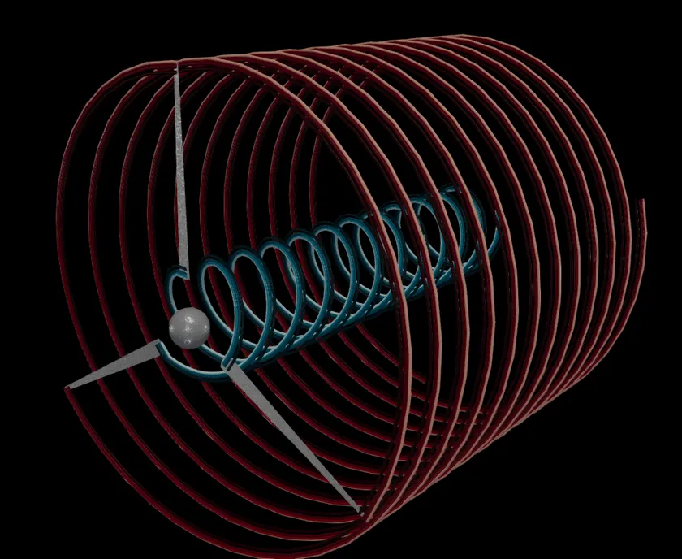
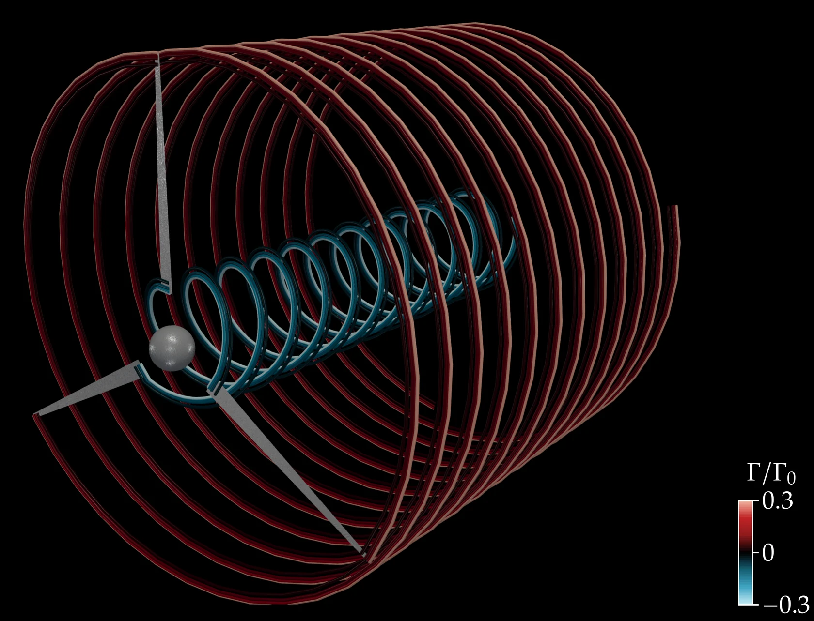

# Lifting-line solver

<p align="center">
  <a href="https://github.com/EngFlavioMartins/lifting-line-solver/actions/workflows/tests.yml"></a>
  <a href="https://www.python.org/"></a>
  <a href="https://github.com/EngFlavioMartins/lifting-line-solver/blob/HEAD/LICENSE"></a>
</p>

**Wind-turbine rotors and their helical wakes, with the lifting-line method.**

<p align="center"></p>

Each blade is a row of horseshoe vortices whose trailing legs follow a helical wake; the bound circulation is iterated against airfoil polars until the loads agree. It gives the spanwise loads, induction factors and the thrust and power coefficients of a rotor in about a second. The derivation is in [Resources/Report.pdf](Resources/Report.pdf).

## Run it

```bash
git clone https://github.com/EngFlavioMartins/lifting-line-solver.git
cd lifting-line-solver
python run.py
```

`run.py` solves a 50 m three-bladed rotor at tip-speed ratio 8 (CT = 0.64, CP = 0.46) and plots the spanwise circulation and induction to `outputs/three_blade_rotor.png`. The first time, it installs what it needs into a private `.venv` folder (a minute or so); after that it starts at once. All you need is Python 3.10 or newer.

<details>
<summary>Prefer conda?</summary>

```bash
conda env create -f environment.yml
conda activate lifting-line-solver
python examples/three_blade_rotor.py
```

</details>

**Next:** The notebook [Examples.ipynb](Examples.ipynb) covers single blades, tip-speed-ratio sweeps and wake convergence. `python -m pytest tests` checks the solver against the original code's results.

## Figure and animation

<p align="center"></p>

The rotor of the example and its wake, drawn to two rotor radii downstream. Each filament is coloured by the circulation it trails, in units of Γ₀ = πU²/(N<sub>b</sub>Ω): red tip vortices, teal root vortices.

```bash
sh scripts/render/make_figure.sh          # the figure
python scripts/render/make_animation.py   # the animation at the top
```

Both need [ParaView](https://www.paraview.org/download/); the figure also needs LaTeX.

## Cite

There is no paper for this solver. If it helps your work, please cite the repository:

```bibtex
@misc{martins_lifting_line,
  author       = {Martins, Flavio A. C.},
  title        = {Lifting-line solver for horizontal-axis wind-turbine rotors},
  year         = {2023},
  howpublished = {\url{https://github.com/EngFlavioMartins/lifting-line-solver}},
  note         = {Software, Apache-2.0 licence}
}
```

GitHub's **Cite this repository** button (from [CITATION.cff](CITATION.cff)) gives the same reference in other formats.

## Licence

[Apache 2.0](LICENSE): you are free to use, change and share this code, also commercially. If you pass it on, keep the [NOTICE](NOTICE) file with it; it says where the code comes from and how to cite it.
