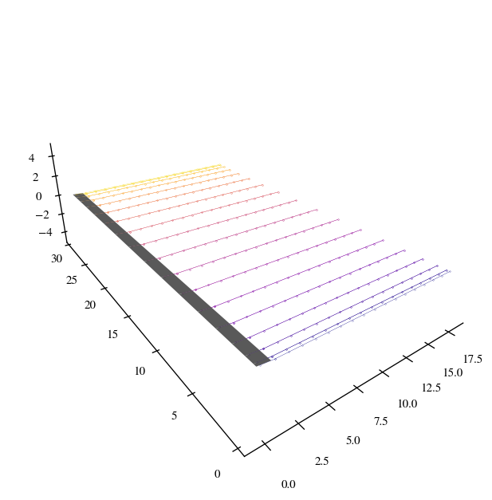
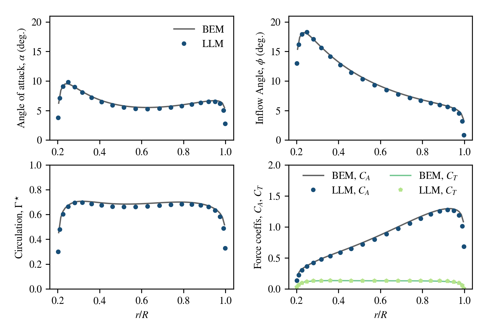
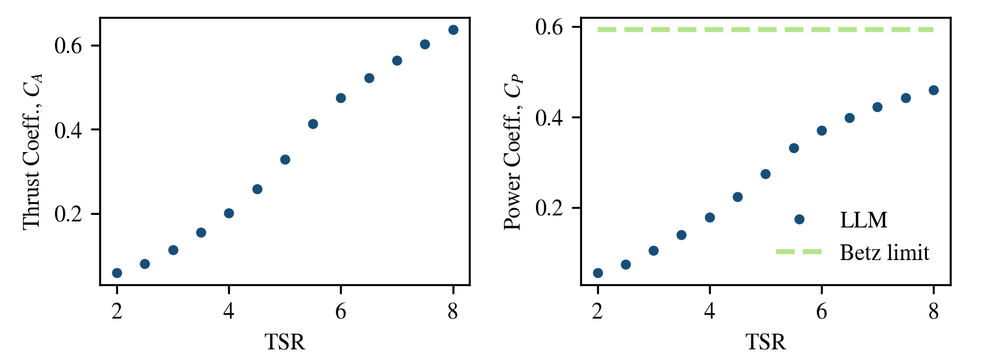

# Lifting Line Method 

Welcome to the Lifting Line Method repository! This project focuses on exploring and analyzing various aspects of aerodynamics of blades and horizontal-axis wind turbines using the Lifting Line theory.
## Table of Contents

- [Project Overview](#project-overview)
- [Features](#features)
- [Installation](#installation)
- [Usage](#usage)
- [Contributions](#contributions)
- [License](#license)

## Project Overview

In this project, we delve into the fascinating world of classical (potential-theory-based) aerodynamics, studying the principles that govern the behavior of fluids (especially air) when interacting with solid objects. Our aim is to apply these principles to different scenarios and objects, ultimately improving our understanding of how aerodynamics influences design, efficiency, and performance of horizontal-axis wind turbines.

## Features

- **Simulations**: We provide a set of simulations tools for designing and modelling blades or rotors, allowing you to visualize airflow around different objects and explore aerodynamic phenomena.
- **Data Analysis**: The project includes tools for analyzing the resulting numerical data related to aerodynamics, helping us draw insights from real-world tests.
- **Educational Resources**: You'll find educational articles, diagrams, and explanations that break down the complex aerodynamic concepts of the classical potential flow theory into understandable components in `./Resources/Report.pdf`.

## Installation

1. Clone the repository using: `git clone https://github.com/PRIDEmartins/Lifting_Line_Method.git`
2. Navigate to the project directory: `cd Lifting_Line_Method`
3. Install the required dependencies: `pip install -r requirements.txt`

## Usage

1. Navigate to the specific simulation or analysis you're interested in using as a reference the provided guide `Examples.ipynb`.
2. Run the relevant script or notebook to generate visualizations or analyze data.
3. Refer to the documentation (`./Resources/Report.pdf`) to understand how to interpret the results.

## Contributions

Contributions are welcome and encouraged! If you have ideas for improving simulations, adding new analysis tools, or enhancing educational resources, feel free to fork this repository and create a pull request. Please ensure your changes align with the project's goals.

## License

This project is licensed under the [MIT License](LICENSE). You're free to use, modify, and distribute the code as long as you include the original license in your distribution.

---

Happy exploring the world of aerodynamics! If you have any questions or suggestions, please don't hesitate to reach out to us.
